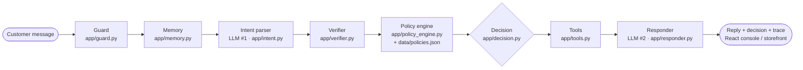
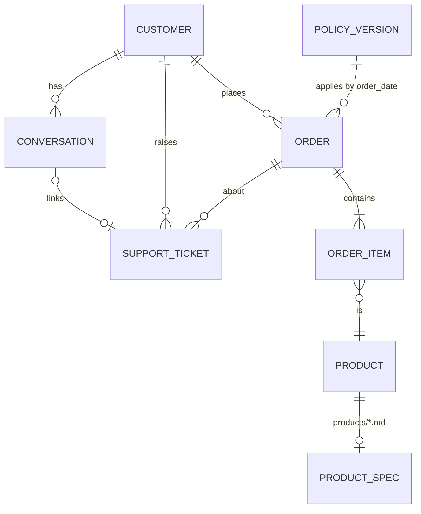

# Architecture

## (a) The agent loop at a glance



## Detailed turn

```mermaid
flowchart TD
    A[Customer message<br/>customer_id · session_id · time] --> G0{0 · Guard<br/>regex, EN + Hinglish}
    G0 -->|flags: injection, legal, safety,<br/>self-harm, abuse, redirect, chargeback| T[Global triggers]
    G0 -->|clean text<br/>injected sentences removed| M[1 · Memory<br/>get_customer · get_conversations<br/>open tickets · pending questions]
    M --> P[2 · Intent parser<br/>LLM #1 JSON schema<br/>or rule parser]
    P --> V1[Python validation<br/>IDs and amounts must appear in text]
    V1 --> MP[Merge follow-ups<br/>'the Sony one', 'yes', 'already sent it']
    MP --> L{for each intent<br/>in dependency order}
    L --> R[3 · Verifier<br/>get_order · ownership · ambiguity<br/>item selection · risk signals]
    R --> PE[4 · Policy engine<br/>version by order date · day-N window<br/>loyalty · restocking · cap · threshold · warranty]
    PE --> D{5 · Decision}
    T --> D
    D -->|safety / legal / OTP dispute / over threshold<br/>repeat claims / suspended / ≥2 fraud signals| E[ESCALATE]
    D -->|missing · ambiguous · no evidence<br/>contradiction (first time)| Q[ASK]
    D -->|eligible + within authority| X[ACT]
    D -->|informational / declined with reason| N[ANSWER]
    X --> W[6 · Write tools<br/>create_refund · create_return<br/>create_support_ticket]
    E --> H[escalate_to_human<br/>one per turn, full context]
    W & H & Q & N --> DR[Deterministic draft reply<br/>per-intent messages]
    DR --> RW[7 · Response writer<br/>LLM #2 rephrase]
    RW --> C{Python check<br/>no new amounts/IDs<br/>no internal fields}
    C -->|pass| OUT[reply + decision + intents<br/>tool_calls + reasoning]
    C -->|fail| OUT2[template reply]
    OUT2 --> OUT
```

## (b) Data model



## Decision priority

1. **Global triggers → ESCALATE** (self-harm, safety incident, legal or regulatory threat, threats or repeated abuse,
   chargeback, refund to another account, human requested). Intents are still verified in *dry-run* mode so the
   reply can state facts ("ORD-x was ₹1,299, so ₹50,000 isn't possible"), but **no write tool runs**.
2. **Injection** is ignored: injected sentences are removed and the genuine request continues. Injection also
   counts as one soft fraud signal.
3. **Per-intent escalation**: OTP-verified delivery disputed, ≥3 claims in 90 days, suspended account, order total
   above the version's approval threshold, ≥2 soft fraud signals (amount > order total, injection, authority claim,
   2 recent claims, fraud-suspicion ticket), repeated contradiction, second replacement on the same item.
4. **ASK**: order unknown, not owned, ambiguous or not matching; item ambiguous; reason missing; evidence missing
   for defect claims; new address missing; first contradiction with the record.
5. **ACT**: eligible under policy and within authority (refund, return, replacement, warranty claim, cancellation,
   address change, logistics/payment ticket).
6. **ANSWER**: status, info, or a decline with the policy reason and the next-best option.

Overall turn decision = highest priority among intents (ESCALATE > ACT > ASK > ANSWER). Per-intent decisions are
returned in `intents[]`.

## Multi-intent dependencies

The parser marks `depends_on` (e.g. refund → delivery claim). If the parent outcome is unresolved (investigation,
escalation, in transit), the dependent intent is **held** and explained rather than executed. Address changes on
delivered or lost orders become an ASK ("save it for future orders?").

## Efficiency

- At most **2 LLM calls per turn** (parse + phrase), each at effort `low` with a cached system prompt. Greetings and
  no-key mode use **0** calls.
- Tools are called only when needed; identical reads are deduplicated within a turn; `get_conversations` runs once
  per session.
- Typical deterministic turn: under 20 ms.

## Components

| Component | File | Responsibility |
|---|---|---|
| Config / clock | `app/config.py` | env settings; "now" = request `current_time` > `AGENT_NOW` > wall clock (IST) |
| Data layer | `app/data.py` | loads 6 CSVs + conversations.json + 300 product spec sheets once; typed IST dates; indexes by customer/order |
| Policy store | `app/policy_store.py` | versioned `data/policies.json`, selection by order placement date, hot reload on file change |
| Policy engine | `app/policy_engine.py` | day-N windows, loyalty extension, in-time request exception, refund cap + GST + restocking, threshold, warranty, delays |
| Tools | `app/tools.py` | the 10 handbook tools, `ToolTracer` (records every call), write log + duplicate-action guard |
| Guard | `app/guard.py` | regex risk flags (EN + Hinglish); strips injected sentences |
| Intent parser | `app/intent.py` | LLM #1 with JSON schema; rule parser fallback; Python validation of LLM output |
| Verifier | `app/verifier.py` | order/item resolution, ownership, ambiguity options, repeat-claims and fraud signals |
| Decision engine | `app/decision.py` | one handler per intent type → ANSWER/ASK/ACT/ESCALATE + customer message + audit reasons |
| Memory | `app/memory.py` | sessions, pending questions, story-change tracking, prior evidence, open tickets |
| Responder | `app/responder.py` | LLM #2 rephrases the verified draft; rejected if it adds amounts/IDs or drops references |
| Orchestrator | `app/agent.py` | one turn end to end; global triggers; one escalation per turn |
| API | `app/main.py` | FastAPI per `API_CONTRACT.md` (+ products, categories, demo reset) |
| UI | `frontend/` | React console (chat + Agent Brain timeline) and customer storefront with support widget |
